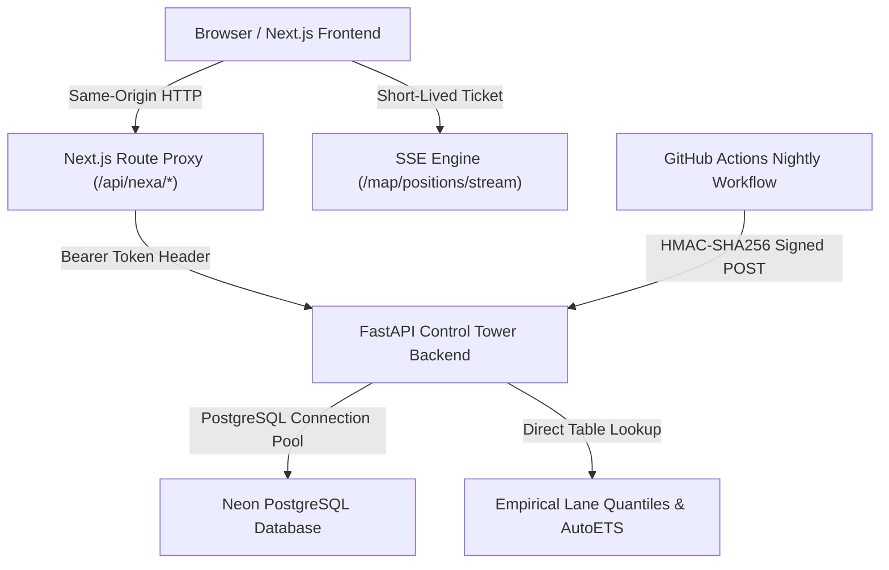

# NexaFreight Architecture Specification

## 1. System Overview

NexaFreight is an AI-augmented Multimodal Logistics Control Tower designed for real-time shipment monitoring, proactive disruption mitigation, carbon emission tracking, and automated rerouting.

---

## 2. Core Architectural Decisions

### ADR-01: Same-Origin Reverse Proxy Routing
- **Problem**: Direct cross-origin browser requests (`https://frontend.vercel.app` -> `https://backend.onrender.com`) require wide CORS permissions, expose backend infrastructure URLs, and risk leaking bearer tokens.
- **Solution**: The Next.js frontend implements server-side route proxies (`/api/nexa/:path*`) directing traffic to `BACKEND_URL`.
- **Invariants**:
  - Direct backend communication via `NEXT_PUBLIC_NEXA_API_URL` is dev-only opt-in.
  - Production builds never issue requests to `localhost` or `127.0.0.1`.
  - Bearer tokens are never attached to cross-origin or loopback requests.

### ADR-02: Short-Lived Single-Use SSE Stream Tickets (SEC-03)
- **Problem**: Standard browser `EventSource` cannot send custom `Authorization: Bearer` headers. Passing long-lived session JWTs in query parameters (`?token=...`) leaks tokens in access logs, proxy caches, and browser history.
- **Solution**:
  1. Frontend calls `POST /api/map/positions/stream-ticket` with its Authorization header before every connect and reconnect.
  2. Backend issues an HMAC-signed single-use ticket valid for 60 seconds with claim `scope: "stream_positions"` and unique `jti`.
  3. Frontend opens `EventSource('/api/map/positions/stream?ticket=<ticket>')`. The URL carries only the single-use ticket, never the user JWT.
  4. Backend verifies and immediately consumes the ticket `jti` in a TTL cache, enforcing single-use and preventing replay attacks.
  5. Access tokens are rejected as stream tickets, and stream tickets are rejected as access tokens. Stream lifetime is capped at 900s (~15 min), triggering an automatic client refetch and reconnect.
  6. Query param `?token=` is deprecated and rejected backend-wide.

### ADR-03: Append-Only Immutable Audit Log (SEC-09)
- **Problem**: Compliance and security require that operational decisions, operator approvals, and LLM reasoning traces cannot be tampered with or purged.
- **Solution**:
  - The `audit_logs` table does not implement update timestamps (`TimestampMixin`).
  - PostgreSQL trigger `prevent_audit_log_modification()` raises an exception on any `UPDATE` or `DELETE` statement.
  - SQLite compatibility is maintained via matching `BEFORE UPDATE` and `BEFORE DELETE` triggers using `RAISE(FAIL, ...)`.

### ADR-04: Out-of-Process Nightly Cron Ingestion
- **Problem**: In-process background schedulers (e.g. APScheduler) in multi-worker or autoscaling container environments cause duplicate job execution, memory leaks, and job overlap.
- **Solution**:
  - In single-worker production demo environments, internal background workers are enabled (`ENABLE_SCHEDULER=true`) to run the position interpolator, disruption detector, SLA checker, and AIS stream listener.
  - Multi-worker or autoscaling environments can disable internal scheduling loops (`ENABLE_BACKGROUND_SCHEDULER=false`), relying on `.github/workflows/nightly.yml` sending an HMAC-SHA256 signed request to `POST /internal/nightly`.
  - Constant-time verification (`hmac.compare_digest`) and a 300-second timestamp drift window prevent replay attacks.

### ADR-05: GLEC Framework Emissions Accounting
- **Problem**: Divergent emission factors across modules caused mathematical discrepancies between leg-level emissions and Network KPI aggregations.
- **Solution**:
  - Unified default emission factors derived from GLEC default intensity factors (basis not independently verified):
    - **AIR**: 602.0 g CO2e / tonne-km
    - **ROAD**: 62.0 g CO2e / tonne-km
    - **RAIL**: 22.0 g CO2e / tonne-km
    - **SEA**: 16.1 g CO2e / tonne-km
  - All calculation paths (`params.py`, `route_planner.py`, `financial_engine.py`, migration backfills) consume the centralized `DEFAULT_CO2_FACTORS` source of truth.

---

## 3. Data Provenance Taxonomy

Every data point rendered across UI cards, dossier panels, and API responses carries explicit provenance:

| Provenance Label | Definition | Examples |
| :--- | :--- | :--- |
| **`REAL`** | Verified real-time telemetry from live external signals | Live AIS vessel coordinates, port status |
| **`CALIBRATED`** | Empirical parameters derived from official standards | GLEC v3.2 emission factors, demurrage rates |
| **`DERIVED`** | Reconstructed or computed via mathematical modeling | Historical DataCo shipment legs, lane quantiles |
| **`SIMULATED`** | Synthetic intervals or dead-reckoning fallbacks | Kinematic interpolation between AIS pings |
