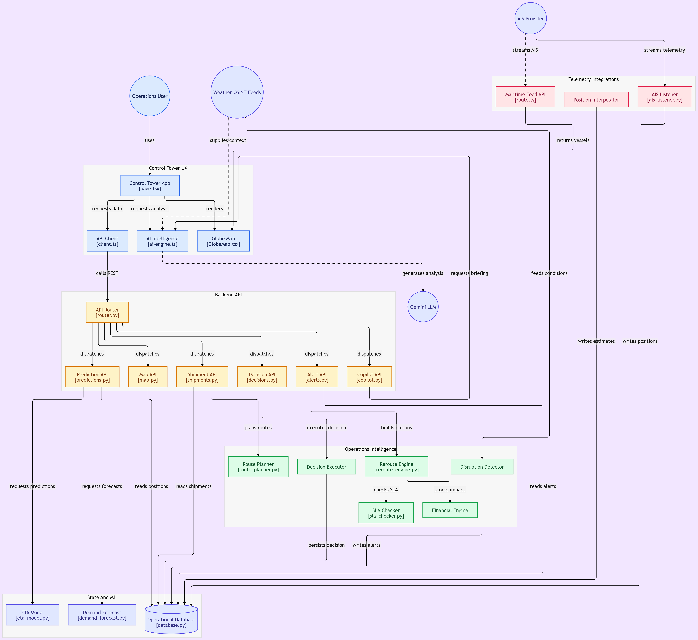

<div align="center">

# NexaFreight

### Autonomous Multimodal Logistics & Maritime Intelligence Control Tower

[](https://github.com/rajmontana/NexaFreight/actions/workflows/ci.yml)
[](https://fastapi.tiangolo.com)
[](https://nextjs.org)
[](https://python.org)
[](https://www.typescriptlang.org)
[](LICENSE)

*An enterprise-grade platform uniting real-time AIS vessel telemetry, intermodal route optimization, predictive delay machine learning, automated disruption recovery, and an AI Operations Copilot powered by Google Gemini.*

---

</div>

## 📌 Overview

Global supply chain operations are inherently fragmented. Ocean container shipping, air cargo, railway freight, and line-haul trucking operate in disconnected data silos. When chokepoints bottleneck—whether through canal advisories, port congestion, or extreme weather—logistics teams discover delays days late, incurring severe demurrage penalties and missed customer SLAs.

**NexaFreight** bridges this gap as a 24/7 autonomous multimodal control tower. It continuously ingests real-world maritime and transit telemetry, predicts disruptions before arrival scans, automatically evaluates **3 deterministic recovery options** (Accept, Divert, Modal Shift), and enforces an auditable **Data Provenance Standard** across all metrics.

---

## 🏗️ Architecture

```
┌─────────────────────────────────────────────────────────────────────────┐
│                      Next.js 16 Frontend (Port 3000)                    │
│   • Tactical 3D Globe & Flat Mercator Canvas (MapLibre GL)              │
│   • Operations Manifest Ledger & Deep Shipment Dossier                  │
│   • Operational Analytics & StatsForecast AutoETS Demand Forecasting (Recharts)       │
│   • 3-Way Disruption Triage Desk & Audit Trail Ledger                   │
│   • Persistent AI Copilot Quick Dock (Google Gemini + Rule Engine)      │
│   • Real-Time Position Stream Consumer (Server-Sent Events)             │
└────────────────────────────────────┬────────────────────────────────────┘
                                     │ REST APIs & SSE Stream (:8000)
┌────────────────────────────────────▼────────────────────────────────────┐
│                      FastAPI Backend (Port 8000)                        │
│   • Telemetry Engine: AISStream live WebSocket & Linear Interpolator    │
│   • Multimodal Router: Sea (searoute), Highway (ORS/OSRM), Air & Rail   │
│   • Time-Expanded Graph Planner: Yen's k-shortest paths optimization    │
│   • Predictive ML: LightGBM delay classifier & StatsForecast AutoETS    │
│   • Disruption Engine: SLA-cushion relative severity classification     │
│   • Financial & ESG Engine: Waterfall P&L, demurrage & GLEC CO2 kg      │
│   • Database: SQLite (local dev) / PostgreSQL 16 (production)           │
└─────────────────────────────────────────────────────────────────────────┘
```

<div align="center">
  
</div>

---

## ⚡ Core Capabilities

### 1. Global Multimodal Visibility & Real-Time Telemetry
- **Live Vessel Tracking**: Ingests real-time AIS transponder streams (`aisstream.io`) for maritime container fleets.
- **Intermodal Corridor Engine**: Renders true journeys across sea lanes, highway road networks (via ORS/OSRM), dedicated railway freight corridors, and parabolic great-circle flight paths.
- **Dynamic Linear Interpolator**: High-frequency position server computing sub-second vehicle headings and forward tangents along active route geometries.
- **Server-Sent Events (SSE)**: Sub-second position updates streamed directly to the MapLibre GL frontend canvas.

### 2. Autonomous Disruption & Deterministic 3-Way Triage
- **Cushion-Relative Detection**: Evaluates disruption severity relative to each shipment's remaining SLA buffer instead of arbitrary global delays.
- **3 Deterministic Recovery Scenarios**:
  1. **Accept Delay**: Evaluates liquidated damages, customer impact, and demurrage accrual.
  2. **Port Divert**: Computes alternative seaport bypasses with incremental nautical miles, onward drayage, and CO2 trade-offs.
  3. **Modal Shift**: Triggers emergency air or expedited rail links when SLA penalty risk exceeds modal transition costs.
- **Audit Logging**: Approved operator decisions commit directly to an immutable database ledger with before/after variance tracking.

### 3. Predictive Machine Learning & Forecasting
- **Delay Classifier (LightGBM)**: Trained on historical supply chain data with strict chronological splits and post-hoc leakage bans. **Validation AUC: 0.7315**, PR-AUC: 0.791 (predominantly recovers synthetic mode-schedule labelling rules; see Limitations).
- **Demand Forecasting (StatsForecast AutoETS)**: Models forward cargo volume across **79 international trade corridors** with 80% confidence intervals. **WAPE: 32.16%** (+26.9% lift over seasonal-naive baselines; note that underlying DataCo order volumes are synthetic).
- **ETA Quantile Residual Estimator**: Calibrated empirical lane transit-time residual quantiles evaluating $p_{10}$, $p_{50}$, and $p_{85}$ margins for operational risk banding (`ON_TIME`, `MEDIUM`, `HIGH`, `BREACH`). Provenance: `DERIVED`.

### 4. Operational Financials & GLEC Carbon Accounting
- **Waterfall P&L Engine**: Real-time freight revenues, fuel adjustment factors (BAF), terminal handling charges (THC), and detention risk in Indian Rupees (₹) and USD.
- **Demurrage Tracking**: Automatic calculation of daily demurrage liabilities after standard free days expire.
- **GLEC Carbon Accounting**: Multimodal greenhouse emission calculations ($kg\ CO_2$ per tonne-kilometer) compliant with Global Logistics Emissions Council standards.

### 5. NexaFreight AI Operations Copilot
- **Hybrid Dispatch Architecture**:
  - *Deterministic Fast Path*: Regex and rule parsers for zero-latency, zero-hallucination lookups (shipment IDs, vessel status, demurrage balance, active alerts).
  - *Generative Advisory Path*: Injects active shipment context, port congestion, and SLA margins into **Google Gemini** for root-cause analysis and qualitative trade-off explanations.
- **Persistent Global Dock**: Floating, collapsible assistant dock accessible across all pages with quick-prompt chips.

### 6. Strict Data Provenance Standard
Every metric, cost, and coordinate on the platform is explicitly tagged with an audit badge:
- `REAL`: Raw, direct telemetry from live external sensors (live AIS ping, Open-Meteo weather report).
- `CALIBRATED`: Empirical models verified against real historical baselines (demurrage rates, port turnaround times).
- `DERIVED`: Mathematically computed from genuine operational data (Yen's planned legs, GLEC CO2, P&L waterfall).
- `SIMULATED`: Synthetically generated for demo continuity (simulated between-port vessel interpolation).

---

## 📊 Data Foundations

NexaFreight is built upon 5 industry-standard datasets:

| Dataset | Source / Provider | Records | Operational Role |
|---|---|---|---|
| **UN/LOCODE** | United Nations UNECE | 84,000+ nodes | Standardized geocoded registry of global seaports, cargo airports, rail depots, and container freight stations. |
| **IMF PortWatch** | International Monetary Fund & Oxford | Daily series | Real vessel calls and trade estimates; computes daily port `congestion_index = daily_calls / rolling_90d_avg`. |
| **Kaggle Maritime & World Port Index** | World Bank & NGA | Global terminals | Provides port berth capacities, container turnaround times, and LOCODE alias resolution via RapidFuzz. |
| **DataCo Smart Supply Chain** | Kaggle / Mendeley | 65,752 orders | Powers multimodal shipment itineraries, customer SLA thresholds, and historical delay training sets. |
| **NOAA MarineCadastre AIS** | NOAA & USCG | Snappy Parquet | Historical ship telemetry and speed profiles used for realistic maritime movement replay. |

---

## 🖥️ Application Screens

The frontend is organized into 5 dedicated, high-density operational surfaces:

1. **Tactical Control Tower (`/`)**:
   - Interactive 3D globe / flat Mercator canvas (MapLibre GL) with technical chartroom aesthetics.
   - Live moving ships, cargo planes, and freight trucks with directional route-facing headings.
   - Headline KPI band: Active Shipments, In-Transit, SLA Risk, Demurrage Liability (₹), and Network CO2.
   - Slide-over shipment inspection drawer and real-time alert dispatch pills.
2. **Shipment Manifest Ledger (`/shipments`)**:
   - Full-page paginated operations table with status and transport mode filters.
   - Displays lane origins/destinations, milestone progress bars, ETA variances ($\pm\text{hours}$), and landed costs in ₹.
3. **Shipment Dossier (`/shipments/[id]`)**:
   - Deep-dive operational view featuring live time-to-destination countdowns, schedule slip counters, route mini-maps, sequential milestone leg cards, itemized P&L breakdowns, and Copilot risk verdicts.
4. **Operational Insights (`/insights`)**:
   - Comprehensive analytics suite with carrier SLA compliance trends, modal GLEC CO2 footprint ledgers, demurrage loss waterfalls, and the MOD-407 StatsForecast AutoETS demand forecast curves for 79 trade lanes.
5. **Disruption Queue (`/alerts`)**:
   - Incident queue classifying bottlenecks by SLA cushion impact with the **3-Way Recovery Desk** modal for executing Accept, Divert, or Modal Shift decisions.

---

## 🗂️ Project Directory Structure

```
.
├── backend/
│   ├── migrations/             # Alembic database migration chain
│   ├── models/                 # Pre-trained ML model artifacts (LightGBM, StatsForecast AutoETS)
│   ├── scripts/                # Data ingestion pipelines, seeding & fleet sync
│   ├── src/nexafreight/        # Application source code
│   │   ├── api/                # FastAPI routers (shipments, alerts, telemetry, copilot, etc.)
│   │   ├── core/               # Configuration, security, params registry & clock
│   │   ├── models/             # SQLAlchemy ORM models & Pydantic schemas
│   │   ├── services/           # Routing, planner, disruption, financial & copilot engines
│   │   └── workers/            # Position interpolator & AIS listener workers
│   ├── tests/                  # Backend test suite (660+ unit & integration tests)
│   ├── alembic.ini             # Database migration configuration
│   └── requirements.txt        # Backend dependencies
│
├── frontend/
│   ├── public/                 # Static assets, branding marks, and vector maps
│   ├── src/
│   │   ├── app/                # Next.js App Router pages (/, /shipments, /insights, /alerts)
│   │   ├── components/         # Chartroom tactical components (GlobeMap, Copilot, Ledger)
│   │   ├── hooks/              # Custom React hooks (SSE telemetry stream, fleet KPIs)
│   │   └── lib/                # API client, geo math, INR formatters, and style tokens
│   ├── package.json            # Node.js dependencies
│   ├── tsconfig.json           # TypeScript configuration
│   └── vitest.config.ts        # Vitest test runner configuration
│
├── docker-compose.yml          # Container configuration for production parity
├── Makefile                    # Developer shortcut commands
└── README.md                   # Project documentation
```

---

## 🚀 Quickstart Guide

### Prerequisites
- **Python**: 3.11 or newer
- **Node.js**: 20.x or newer, with `npm`
- **Git**

---

### 1. Backend Setup

```bash
# 1. Navigate to backend directory
cd backend

# 2. Create and activate a virtual environment
# Windows (PowerShell):
python -m venv .venv
.\.venv\Scripts\Activate.ps1

# Linux / macOS:
# python3 -m venv .venv && source .venv/bin/activate

# 3. Install dependencies
pip install --upgrade pip
pip install -r requirements.txt
pip install -e .

# 4. Configure environment variables
cp .env.example .env
# Set JWT_SECRET in .env (and optional GEMINI_API_KEY, AIS_API_KEY, ORS_API_KEY)

# 5. Run database migrations
alembic upgrade head

# 6. Seed operational data & fleet orchestrator
python scripts/seed_user.py
python scripts/06_seed_analytics.py
python scripts/activate_and_seed_positions.py

# Optional: Run real-world DataCo fleet synchronization
python scripts/sync_real_world.py --limit 200

# 7. Start the FastAPI development server
uvicorn nexafreight.main:app --host 0.0.0.0 --port 8000 --reload
```

*Interactive Swagger API documentation will be available at: `http://localhost:8000/docs`*

---

### 2. Frontend Setup

```bash
# 1. Open a new terminal and navigate to frontend directory
cd frontend

# 2. Configure environment variables
cp .env.example .env.local
# Verify NEXT_PUBLIC_NEXA_API_URL=http://localhost:8000

# 3. Install Node dependencies
npm ci

# 4. Start Next.js development server
npm run dev
```

*Open your browser at: `http://localhost:3000`*

**Operator Authentication:**
- Seed scripts create `operator@nexafreight.dev` reading `SEED_PASSWORD` from the environment, or auto-generate a secure random password printed to console at seed time:
  ```bash
  SEED_PASSWORD=my_secure_password python backend/scripts/seed_demo_data.py
  ```

---

## 🧪 Testing & Verification

NexaFreight enforces comprehensive test coverage across both tiers:

```bash
# --- Backend Test Suite (660+ tests) ---
cd backend
pytest tests/unit -q

# --- Frontend Unit Tests (344 tests across 25 suites) ---
cd frontend
npx vitest run

# --- Frontend Typecheck ---
cd frontend
npx tsc --noEmit

# --- Production Build Validation ---
cd frontend
npm run build
```

---

## 🔌 API Summary

| Method | Endpoint | Description |
|---|---|---|
| `POST` | `/api/v1/auth/login` | Authenticates operator and returns JWT bearer token |
| `GET` | `/api/v1/shipments` | Lists multimodal shipments with mode and status filters |
| `GET` | `/api/v1/shipments/{id}` | Detailed manifest, waypoint milestones, and SLA margins |
| `GET` | `/api/v1/shipments/{id}/route` | GeoJSON route geometry coordinates for vector maps |
| `GET` | `/api/v1/shipments/{id}/financials` | Detailed freight rate, demurrage risk, and P&L breakdown |
| `GET` | `/api/v1/telemetry/stream` | Server-Sent Events (SSE) live position stream |
| `GET` | `/api/v1/map/ports` | Port location registry and live IMF congestion indices |
| `GET` | `/api/v1/alerts` | Active operational disruption queue |
| `POST` | `/api/v1/alerts/{id}/options` | Evaluates 3 deterministic recovery options (Accept, Divert, Shift) |
| `POST` | `/api/v1/decisions` | Commits approved operator decision to immutable audit ledger |
| `GET` | `/api/v1/analytics/summary` | Executive KPI scorecard, volume, revenue, and CO2 emissions |
| `POST` | `/api/v1/copilot/chat` | Dispatches query to AI Copilot (deterministic rule / Google Gemini) |

---

## ⚠️ Model Limitations & Scientific Benchmarks

- **Delay Risk Classifier (Synthetic Label Recovery)**: Trained on the DataCo Smart Supply Chain dataset. Single-feature evaluation shows `scheduled_shipping_days` alone achieves **0.7289** test ROC-AUC, exceeding the full 14-feature LightGBM model (**0.7273**; mean difference -0.0016, 95% bootstrap CI `[-0.0075, +0.0044]`). The full model adds zero incremental predictive value over scheduled shipping days alone or a joint `(shipping_mode x scheduled_shipping_days)` baseline. Removing mode and schedule collapses test ROC-AUC from 0.7273 to **0.5007** (random guessing). Furthermore, "shipping mode" in DataCo is a proxy for commercial service classes (`Standard Class` → SEA, `Second Class` → RAIL, `First Class / Same Day` → AIR; 0 ROAD rows exist), each with static scheduled days. The classifier predominantly recovers DataCo's deterministic synthetic labelling rule rather than real-world delay dynamics; test AUC (~0.727) does not indicate real-world operational delay predictability. LightGBM early stopping (not Optuna trial limits) halts tree induction at iteration 3 (`best_iteration: 3`) because additional trees add no genuine signal beyond the mode mapping.
- **ETA Quantile Estimators ($p_{10}, p_{50}, p_{85}$)**: Shipped with provenance `DERIVED` as service-level empirical bands from synthetic DataCo delays across historical modes (`AIR`: $[1, 1, 1]$, `RAIL`: $[0, 2, 4]$, `SEA`: $[-2, 0, 2]$ days; ROAD and DEFAULT are heuristic assumptions). Serving endpoints (`/api/predict/eta` and `/api/shipments/{id}/predict`) serve directly from `LANE_QUANTILES_TABLE` and never deserialize `model.joblib`. The LightGBM quantile regression trial (-0.23% to -1.94% pinball lift against empirical baselines) is preserved in `backend/eval/` as a documented negative benchmark.
- **Demand Forecasting (Synthetic DataCo Volumes)**: `StatsForecast AutoETS` generates calibrated volume forecasts (WAPE: 32.16%, +26.9% lift over seasonal-naive baselines across 79 lanes), but operators should note that DataCo order volumes are synthetically generated, reflecting procedural order generation rather than macroeconomic trade cycles.
- **Data Provenance**: Explicit distinction between live real-time signals (`REAL`), calibrated empirical benchmarks (`CALIBRATED`), mathematically reconstructed historical orders/routes (`DERIVED`), and simulation intervals (`SIMULATED`).

---

## 📄 License

This project is licensed under the MIT License — see the [LICENSE](LICENSE) file for details.
