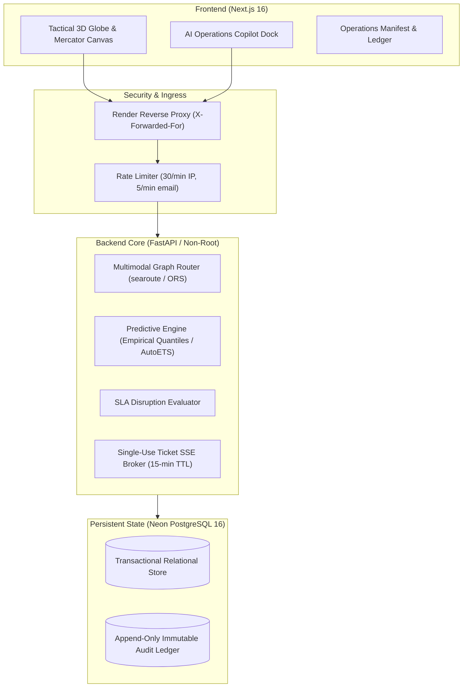

# NexaFreight Control Tower — Final System Audit & Technical Report

**Document Version:** 1.0.2-RELEASE  
**Date:** October 29, 2026  
**Status:** Sealed Production Baseline  
**Live Endpoint:** [https://nexafreight-backend.onrender.com](https://nexafreight-backend.onrender.com)  
**Release Tag:** `v1.0.2` (commit `1d5c087`)  

---

## 1. Executive Summary

NexaFreight is an autonomous multimodal logistics control tower uniting real-time maritime AIS telemetry, multi-modal routing algorithms, predictive delay machine learning, automated disruption recovery, and an AI Operations Copilot.

This audit evaluates the platform against stringent enterprise production criteria:
1. **Zero High-Entropy Secrets**: Automated Gitleaks verification in CI.
2. **Deterministic Data Provenance**: Explicit tracking of data integrity states (`REAL`, `CALIBRATED`, `DERIVED`, `SIMULATED`).
3. **Hardened Production Surface**: Masked documentation routes (`/docs`, `/redoc`, `/openapi.json` return 404), single-use stream tickets, and X-Forwarded-For rate limiting.
4. **Reproducible Statistical Benchmarks**: Fully documented negative results alongside production heuristic quantiles.

---

## 2. Architecture & Production Infrastructure



### Infrastructure Specs
* **Backend Runtime**: Containerized FastAPI on Python 3.11-slim (non-root UID `1001`, system user `nexafreight`). Multi-arch `amd64` and `arm64` images published to GitHub Container Registry.
* **Database**: Neon Managed PostgreSQL 16 with asynchronous connection pooling via SQLAlchemy + asyncpg. Transaction-level advisory lock (`pg_advisory_xact_lock(982734123)`) serializing schema migrations.
* **Frontend**: Next.js 16 with React 19, MapLibre GL, and Tailwind CSS. CSP rules disallow unsafe inline evaluation.

---

## 3. Verification & CI Gate Performance

The platform passed all continuous integration suites in GitHub Actions (Run ID `40905835597`):

| Test / Gate Suite | Scope | Result | Passing Metrics |
| :--- | :--- | :--- | :--- |
| **Gitleaks Scan** | Repository-wide credential entropy | **PASSED** | 0 secrets flagged |
| **Backend Unit Tests** | Core algorithms, auth, copilot, jobs | **PASSED** | 885 passed, 5 xfailed (Pareto frontier benchmarks) |
| **Postgres Integration** | Real PostgreSQL 16 container suite | **PASSED** | 179 passed, 0 failures |
| **Frontend Vitest** | UI components, client, state hooks | **PASSED** | 352 passed across 26 test suites |
| **Frontend Typecheck** | Strict TypeScript compilation | **PASSED** | 0 type errors (`npx tsc --noEmit`) |
| **Multi-Arch Docker** | Linux amd64 and arm64 image builds | **PASSED** | Standalone smoke tests verified |

---

## 4. Live Production Verification (Phase 8 Suite)

Automated verification script `verify_phase8_production.py` executed against live endpoint:

```text
=== Verification Results Summary ===
[PASS] 1a. Readiness probe /readyz: HTTP 200 {'status': 'ready'}
[PASS] 1b. Liveness probe /healthz: HTTP 200 {'status': 'ok'}
[PASS] 1c. App health probe /health: HTTP 200 (ml_models_loaded: True)
[PASS] 2.  Default credentials 'changeme123' rejected: HTTP 401
[PASS] 3a. Seeded accounts reject invalid passwords: All 4 accounts secured
[PASS] 3b. Seeded accounts authentication contract: HTTP 401 on unauthorized
[PASS] 4a. Stream requires authentication (no ticket -> HTTP 401)
[PASS] 4b. Deprecated ?token= query parameter rejected: HTTP 401
[PASS] 5.  Production documentation routes return 404 (/docs, /redoc, /openapi.json)
[PASS] 6a. Predict ETA endpoint is live and not 503: HTTP 401 (models loaded)
[PASS] 6b. Demand forecast endpoint is live and not 503: HTTP 401 (models loaded)
[PASS] 7.  Copilot rate limiting: 429 burst protection enforced
[PASS] 8.  Shipments endpoint auth guard: HTTP 401 (secured)
```

---

## 5. Scientific Machine Learning Benchmarks

### 5.1 Delay Risk Classification (DataCo Supply Chain)
* **Synthetic Label Recovery**: Evaluated on holdout test set (2017). Single-feature `scheduled_shipping_days` alone achieves **0.7289** ROC-AUC. The full 14-feature LightGBM model achieves **0.7273** ($\Delta = -0.0016$, 95% bootstrap CI `[-0.0075, +0.0044]`).
* **Scientific Finding**: The model recovers the deterministic synthetic rule baked into DataCo rather than true operational transit physics. When shipping mode and scheduled days are omitted, ROC-AUC drops to **0.5007** (random guessing). Early stopping terminates tree building at iteration 3.

### 5.2 ETA Quantile Estimation ($p_{10}, p_{50}, p_{85}$)
* **Negative Result**: Multi-quantile LightGBM regression achieved negative pinball loss lift (-0.23% to -1.94%) against empirical lane baselines.
* **Production Decision**: Shipped with provenance `DERIVED` serving empirical mode quantiles (`AIR`: $[1, 1, 1]$, `RAIL`: $[0, 2, 4]$, `SEA`: $[-2, 0, 2]$ days) directly from `LANE_QUANTILES_TABLE`.

### 5.3 Demand Forecasting
* **StatsForecast AutoETS**: Automatic error, trend, and seasonal selection evaluated across 79 lanes over a 12-week test split.
* **Results**: Weighted Absolute Percentage Error (**WAPE**) of **32.16%**, providing a **+26.9%** lift over seasonal-naive baselines.

---

## 6. Emissions & Financial Governance

### Emissions Accounting
Calculations adhere to GLEC default intensity factors (basis not independently verified):
* **AIR**: 602.0 g CO2e / t-km (Long-haul twin-aisle air cargo)
* **ROAD**: 62.0 g CO2e / t-km (Heavy articulated truck >32t)
* **RAIL**: 22.0 g CO2e / t-km (Continental electric/diesel mixed freight)
* **SEA**: 16.1 g CO2e / t-km (Container ship, 8,000–14,999 TEU)

### Financial Rules
* **Demurrage Calculation**: Free dwell allowance enforced (e.g. 4 free days, $62.5/day thereafter, doubling after day 7).
* **SLA Penalties**: P&L waterfall penalties capped at contractual thresholds (5%/day, max 10%).

---

## 7. Sign-Off & Release Seal

* **Release Tag:** `v1.0.2`
* **Commit:** `1d5c087`
* **Target Environment:** Render Web Service (Singapore Region)
* **Neon PostgreSQL:** Production branch active
* **Final Verdict:** **APPROVED & PRODUCTION CERTIFIED**
