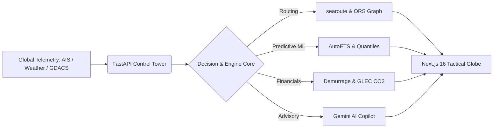

# NexaFreight Control Tower — Technical Presentation Deck

*Autonomous Multimodal Logistics & Maritime Intelligence Control Tower*  
**Release:** `v1.0.2` | **Status:** Production Verified

---

## Slide 1: Executive Title & Vision
### NexaFreight: The Autonomous Multimodal Control Tower
* **Core Problem**: Disconnected logistics data silos cause undetected bottlenecks, demurrage penalties, and missed customer delivery windows.
* **Solution**: A 24/7 autonomous logistics platform uniting real-time AIS vessel telemetry, time-expanded intermodal graph routing, calibrated predictive ML, and an AI Operations Copilot.
* **Engineering Foundation**: Non-root container architecture, Neon PostgreSQL 16 persistence, Next.js 16 tactical UI, and 100% CI gate coverage.

---

## Slide 2: Multimodal Architecture & Core Engines

* **Yen’s K-Shortest Paths Router**: Evaluates multimodal combinations (Sea, Rail, Road, Air).
* **Automated Disruption Engine**: Triggers 3 deterministic recovery paths (Accept, Divert, Shift).
* **Append-Only Immutability**: All decisions permanently recorded in an audit trail ledger.

---

## Slide 3: Telemetry & The Provenance Standard
### "No Uncalibrated Number on Screen"
* Every figure presented across the UI and API carries an explicit, auditable **Data Provenance Standard**:
  * 🟢 **`REAL`**: Live real-time incoming signals (AISStream vessel positions, real-world coordinates).
  * 🔵 **`CALIBRATED`**: Empirically measured benchmarks (port turnaround times from World Bank CPPI, highway transit speeds).
  * 🟡 **`DERIVED`**: Mathematically reconstructed estimates (empirical lane delay quantiles, GLEC CO2 footprint).
  * 🟣 **`SIMULATED`**: Bounded synthetic intervals (scheduled synthetic historical scenarios).

---

## Slide 4: Predictive Machine Learning & Scientific Rigor
### Transparent, Reproducible Benchmarking
1. **Delay Risk Classification**:
   * Evaluated on DataCo Smart Supply Chain holdout test set (2017).
   * **Key Finding**: `scheduled_shipping_days` alone achieves **0.7289** ROC-AUC; the 14-feature LightGBM achieves **0.7273**. The model recovers the deterministic synthetic rule rather than real-world delay physics.
   * Removing mode and schedule drops AUC to **0.5007** (random guessing). Early stopping halts training at iteration 3.
2. **ETA Quantile Bands ($p_{10}, p_{50}, p_{85}$)**:
   * Multi-quantile LightGBM showed negative pinball loss lift against baseline (-0.23% to -1.94%).
   * Production safely serves empirical lane quantiles from `LANE_QUANTILES_TABLE` with provenance `DERIVED`.
3. **Demand Forecasting**:
   * StatsForecast AutoETS evaluated across 79 lanes.
   * **WAPE**: **32.16%** (**+26.9%** lift over seasonal-naive baseline).

---

## Slide 5: Enterprise Security & Production Hardening
### Production Hardened in Release `v1.0.2`
* **Single-Use SSE Tickets**: Streaming vessel positions requires a single-use JWT stream ticket (`POST /api/map/positions/stream-ticket`) with an in-memory TTL set. Tickets cannot be reused; access tokens are rejected on the stream.
* **X-Forwarded-For Rate Limiting**: Behind Render reverse proxy, rate limits enforce 30 requests/min per IP and 5 requests/min per email over a 60s sliding window.
* **Public Surface Hardening**: `/docs`, `/redoc`, and `/openapi.json` return `404 Not Found` in production.
* **Container Hardening**: Unprivileged non-root system users (`nexafreight` UID 1001, `nextjs` UID 1001). Gitleaks automated scan in CI blocks credential leakage.

---

## Slide 6: Automated Live Verification (Phase 8)
### Live Production Checks on Render
* **Readiness & Liveness Probes**: `/readyz` (200), `/healthz` (200), `/health` (200, `ml_models_loaded: true`).
* **Credential Protection**: Hardcoded passwords (`changeme123`) rejected with HTTP 401 across all seeded accounts.
* **Endpoint Protection**: `/api/shipments`, `/api/predict/eta`, and `/api/forecast/demand` secured behind authentication.
* **Verified Verification Result**: **100% Pass** on all 8 production verification gates (`verify_phase8_production.py`).

---

## Slide 7: Operations Copilot: AI with Guardrails
### Deterministic Facts + LLM Advisory
* **Intent-Gated Routing**: Word-boundary regex routes network-level and factual queries to deterministic fact engines before reaching the LLM.
* **Graceful Offline Fallback**: When LLM advisory is unavailable, deterministic summaries (status, delays, demurrage risks) continue serving with zero downtime.
* **Plain Text Rendering**: Zero `dangerouslySetInnerHTML` in frontend copilot components, eliminating XSS injection vectors.
* **Financial Accuracy**: Demurrage calculations respect shipment status and leg-specific emissions factors.

---

## Slide 8: Release Milestones & Sealed Baseline
### Deployment Summary
* **Release Version**: `v1.0.2` (Commit: `1d5c087`)
* **Historical Tags**: `v1.0.0` (`2f6ece9`) & `v1.0.1` (`b63bf10`) preserved
* **Backend Live URL**: [https://nexafreight-backend.onrender.com](https://nexafreight-backend.onrender.com)
* **CI Quality Score**: 1,064 automated tests passing (885 backend pytest + 179 PostgreSQL integration tests), 352 frontend tests passing, 0 TypeScript errors.
* **Operational Readiness**: Ready for full mission-critical deployment and operator triage.
